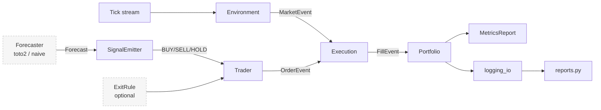
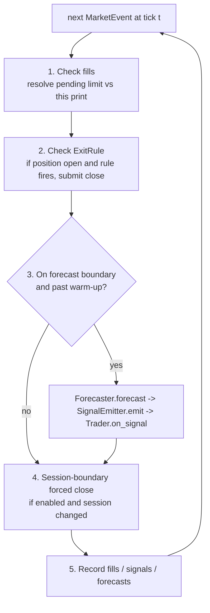
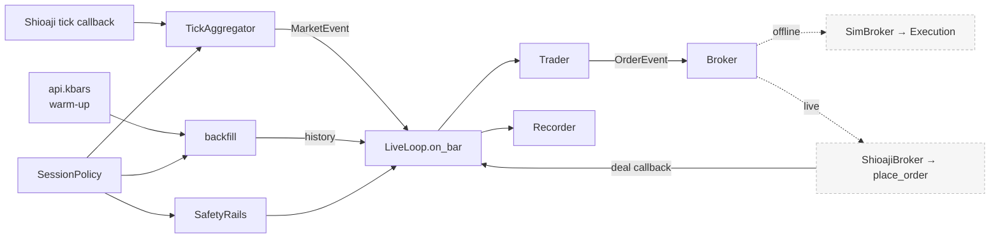

# forecast_eval — documentation hub

A trading-evaluation harness for futures forecasting models, targeting TXF
(Taiwan Stock Exchange Futures) with `toto2` as the reference forecaster.

> **What it answers:** given a forecast model, how much PnL is realizable after
> realistic execution costs, and how much of the model's predictive edge survives
> the trader and execution layers to the final result?

This folder is the **fast-orientation layer**: one page per Python file, each
telling you *what the file owns* and *which file to open next*. For the full
design rationale see [SPEC.md](../SPEC.md); for how to run things see
[usage.md](../usage.md); for environment/interpreter notes see
[CLAUDE.md](../CLAUDE.md).

---

## Architecture at a glance

**Separation of concerns:** the forecasting model, the signal logic, the trader,
and the execution simulator are independent layers — each swappable behind an
abstract interface, so any one can be evaluated in isolation.

## The per-tick event loop

Every `MarketEvent` flows through these five steps in
[run_backtest](run.md) (SPEC §4.1):

Three invariants make this honest (all enforced in code + tests):

- **Look-ahead defense** — the forecaster is handed a freshly-built frame of
  history *through t only*; a runtime guard rejects any forecast stamped past t.
- **Same-tick fill guard** — an order placed at tick t never fills against t's own
  print.
- **No-flip rule** — a SELL while long closes only (never flips to short); same for
  BUY while short. No pyramiding in v1.

---

## File map — open this when…

| File | Role | Open it when you want to understand… |
|---|---|---|
| [events.py](events.md) | Event dataclasses | the data contracts that flow between every layer |
| [environment.py](environment.md) | Tick replay + DAY/NIGHT | how raw ticks become `MarketEvent`s and session tagging |
| [execution.py](execution.md) | Fill simulator | how marketable/passive fills and fees are inferred |
| [portfolio.py](portfolio.md) | Position + PnL accounting | how realized/unrealized PnL and session buckets are kept |
| [trader.py](trader.md) | Signal→order state machine | the no-flip rule and order placement |
| [run.py](run.md) | Backtest driver + demos | the per-tick loop and how everything is wired |
| [metrics.py](metrics.md) | Metric pack | trading metrics, forecast quality (IC), attribution |
| [logging_io.py](logging_io.md) | Artifact writers | the parquet/CSV bundle and `params.json` |
| [reports.py](reports.md) | Charts (PNG + HTML) | equity/drawdown, price+fills, signal-vs-realized |
| [forecaster/base.py](forecaster/base.md) | Forecaster ABC + look-ahead helper | the model contract and the leak guard |
| [forecaster/naive.py](forecaster/naive.md) | Predict-last-price baseline | the zero-skill floor model |
| [forecaster/toto2.py](forecaster/toto2.md) | Toto-2.0 adapter | how the real model is fed and read |
| [strategy/base.py](strategy/base.md) | SignalEmitter ABC | the forecast→signal contract |
| [strategy/dummy.py](strategy/dummy.md) | Alternating emitter | the model-less Phase-1 sanity signal |
| [strategy/threshold.py](strategy/threshold.md) | Threshold emitter | how predicted return becomes BUY/SELL/HOLD |
| [strategy/volmultitf.py](strategy/volmultitf.md) | Volatility + multi-timeframe emitter | the autoresearch exp227 winner's 6-filter cascade |
| [strategy/wiring.py](strategy/wiring.md) | Strategy wiring seam | the `make_strategy()` contract the autoresearch loop edits |
| [exits/base.py](exits/base.md) | ExitRule ABC + PositionState | the risk-exit contract |
| [exits/stop_loss.py](exits/stop_loss.md) | Fixed stop-loss | the N-tick adverse-excursion exit |
| [exits/time_stop.py](exits/time_stop.md) | Time stop | the max-bars-in-trade exit |
| [data/loader.py](data/loader.md) | Tick CSV loaders | the RPT and generic tick file formats |
| [live/cli.py](live/cli.md) — `python -m forecast_eval.live.cli` | The live entry point | how a session starts, and why no order can be sent |
| [live/runtime.py](live/runtime.md) | `LiveRuntime` | the whole assembly minus the network — one policy, and a warm-up that leaves nothing cold |
| [live/config.py](live/config.md) | `LiveConfig` / `PINNED` | the tuned configuration a live run trades, and where it came from |
| [live/sessions.py](live/sessions.md) | `SessionPolicy` | which sessions a deployment trades, and where its trading day begins |
| [live/ledger.py](live/ledger.md) | `FillLedger` | the deployment's fill history across restarts — policy-keyed, soak-scoped, so a resumed run's trades pair right |
| [live/loop.py](live/loop.md) | `LiveLoop` | the §4.1 loop restructured from pull to push |
| [live/bars.py](live/bars.md) | `TickAggregator` | how live ticks become the 1-min bars the model expects |
| [live/backfill.py](live/backfill.md) | `kbars` → bars | warm-up history, and the three corrections `kbars` needs |
| [live/state.py](live/state.md) | `SafetyRails` | what stops a running loop, and why STOP ≠ FLATTEN |
| [live/feedwatch.py](live/feedwatch.md) | `FeedWatch` | telling a quiet market from a broken feed — by asking the venue, not by waiting |
| [live/relogin.py](live/relogin.md) | `ReloginScheduler` | replacing the token before its 24 h wall, in the pre-open quiet |
| [live/relogin_probe.py](live/relogin_probe.md) | §2.24 probe | what a second `login()` actually does — the seven questions the SDK cannot be read for |
| [live/roll.py](live/roll.md) | `RollSchedule` / `RollWatch` | crossing a contract expiry: the plan that trades the position, and the net that catches a missed one |
| [live/ioc_probe.py](live/ioc_probe.md) | IOC-expiry probe | does an expired IOC report anything? the question that blocks the roll's retry ladder |
| [live/alerts.py](live/alerts.md) | `Alerter` | the one door everything needing a human goes through; where a Telegram sink attaches |
| [live/telegram.py](live/telegram.md) | `TelegramNotifier` | alerts to one Telegram chat for every deployment, with a `/settings` button choosing the level |
| [live/startup.py](live/startup.md) | `RestartGuard` | the rails that survive the process dying |
| [live/prices.py](live/prices.md) | `soak_price_series` | the report's price line across every segment of a soak, cached by run |
| [live/recorder.py](live/recorder.md) | JSONL audit trail | what a live session writes down, and why per-line flush |
| [live/artifacts.py](live/artifacts.md) | `ArtifactWriter` | a live run's directory in the backtest's own schema — same `write_all`, so `generate_report` reads a soak |
| [live/capture.py](live/capture.md) | `TickCapture` | the raw feed, written before any filter can touch it |
| [live/contracts.py](live/contracts.md) | contract resolution | reaching a TXF contract, and what counts as "the same" one |
| [live/broker/base.py](live/broker/base.md) | `Broker` ABC | the seam that lets `Trader` drive a real venue unchanged |
| [live/broker/sim.py](live/broker/sim.md) | `SimBroker` | the offline fill model behind the `Broker` API |
| [live/broker/dryrun.py](live/broker/dryrun.md) | `DryRunBroker` | real decisions, real bookkeeping, nothing sent |
| [live/broker/shioaji.py](live/broker/shioaji.md) | `ShioajiBroker` | async fills, cancel races, and contract-code resolution |
| [live/broker/shadow.py](live/broker/shadow.md) | `ShadowBroker` | V4's fill-model gap: the sim model run beside the real one |
| [live/v4_probe.py](live/v4_probe.md) | forced-order probe | drives one order through the real V4 stack on demand |
| [live/v1_check.py](live/v1_check.md) | ticks ⟷ `kbars` diff | V1's live half: do our bars match the venue's? |
| [live/v1c_check.py](live/v1c_check.md) | `kbars` convention probe | how the right-labelling was discovered |
| [live/v72_probe.py](live/v72_probe.md) | simulation-ordering probe | how "can we even place a futures order?" was answered |
| [live/credentials.py](live/credentials.md) | `load(deployment)` | which API key a deployment logs in with, and the guards that stop one being committed |
| [live/soak_epoch.py](live/soak_epoch.md) | soak identity | what `--fresh-start` and `--resume` actually mean across a restart |
| [live/seed_cache.py](live/seed_cache.md) | warm-up bar cache | why a restart does not re-backfill from scratch |
| [live/flatten.py](live/flatten.md) | close whatever is held | the one tool that closes a position nothing else can — and now says whose lots it is closing |
| [live/multi_deploy_probe.py](live/multi_deploy_probe.md) | S7/S8/X1-X3 probes | every question about concurrent deployments that had to be measured, not read |

**The owning process** (STRATEGY_SPLIT_PLAN §18) — one process places every
order for all three deployments, because §14 measured that a shared account
delivers deals per session but a position book to everyone.

| file | what it is | open it when you want… |
|---|---|---|
| [live/owner_cli.py](live/owner_cli.md) — `python -m forecast_eval.live.owner_cli` | the owner entry point | how the owner starts, seeds and refuses |
| [live/owner.py](live/owner.md) | `OrderBook` / `plan_legs` | N working orders across three deployments, and why a `Cover` is never over-sized |
| [live/owner_process.py](live/owner_process.md) | `OwnerProcess` | the venue-facing half: one callback, the place path, two different reconciliations |
| [live/intents.py](live/intents.md) | `JsonlStream` | the wire between the deployments and the owner, and the three rules that stop an order going missing |
| [live/broker/client.py](live/broker/client.md) | `ClientBroker` | a deployment's end of that wire — and why a silent owner halts it |
| [run.py](run.md) — `python -m forecast_eval.run` | Phase 1–4 synthetic demos | a no-model, seconds-long smoke run |
| [real_data.py](real_data.md) | Full-dataset run with warmup split | the whole-history real-data backtest |
| [test_toto2.py](test_toto2.md) | Toto2 smoke test | the smallest "is the model wired up" check |
| [tests/](tests.md) | Unit + integration suite | what's covered and how to run it |

**Offline tools** — run by hand, never imported by the framework. The first three
are the evaluated-tape rebuild (`TAPE_REBUILD_PLAN.md`), in the order they run.

| file | what it is | open it when you want… |
|---|---|---|
| [tools/build_minute_bycontract.py](tools/build_minute_bycontract.md) | raw `.rpt` → minute bars per `(contract, minute)` | to rebuild the tape source from 55 GB of TAIFEX files (~28 min) |
| [tools/build_session_tapes.py](tools/build_session_tapes.md) | that intermediate → the four evaluated tapes | to re-cut day / night / combined / full-day on their own splice instants (33 s) |
| [tools/diff_tapes.py](tools/diff_tapes.md) | old tape vs new, attributed by cause | to know *why* a bar moved — splice, unstable sort, duplicate file, or session filter |
| [tools/band_sweep.py](tools/band_sweep.md) | band × min-prob search, scored out-of-sample | to re-run W5b's grid off one GPU precompute (~160 s for 33 cells) |
| [tools/session_artifacts.py](tools/session_artifacts.md) | a finished live run's artifacts and report, rebuilt from its `session.jsonl` | for runs that ended before `live/artifacts.py` existed |
| [tools/roll_parity.py](tools/roll_parity.md) | the shipped tape vs the series the live warm-up would build, at every roll | to ask whether the tape and the deployment are one series — NIGHT 112/112, DAY 183 rolls adrift |
| [tools/roll_at_measure.py](tools/roll_at_measure.md) | per-session liquidity around the roll | the raw evidence behind `ROLL_AT` (C4) |
| [tools/g6_live.py](tools/g6_live.md) | G6's live half | to prove two deployments can hold at once against a real session — the run that lifts §15 |

> `__init__.py` files (`forecast_eval/__init__.py`, and the package `__init__.py`
> under `data/`, `forecaster/`, `strategy/`, `exits/`, `tests/`, `live/`,
> `live/broker/`) are empty or near-empty package markers — nothing to document.
> `tools/` has no `__init__.py` — it is a namespace package, which is why the
> tools run as `python -m forecast_eval.tools.<name>` from `night/`.

## The live path

`live/` is the **additive** live-trading layer: the same strategy stack driven by
a real feed instead of a replayed file. `run.py`, `execution.py`, `trader.py` and
`portfolio.py` are **unmodified** — the seam is duck-typed.

Three things to know before reading the code:

- **`SimBroker` exists so the live loop can be diffed against `run_backtest`**
  over the same ticks. That parity gate is what proves the pull→push
  restructuring changed no decision logic.
- **The session is a parameter, never a default.** One
  [SessionPolicy](live/sessions.md) is passed to the aggregator, the backfill and
  the rails; no module names a session.
- **Every safety rail defaults to halting**, and `STOP` (send nothing) is
  distinct from `FLATTEN` (close, then stop) — see [live/state.py](live/state.md).

Design, phase status and measured findings live in
[SHIOAJI_PLAN.md](../SHIOAJI_PLAN.md).

**Operating a running simtrade** (stop, pause, restart, halts, the daily
timeline, reports while it runs, and a dated current-status section) is the
task page
[simtrade_operations.md](simtrade_operations.md).

---

## Recommended reading order

For a newcomer grasping the codebase from scratch:

1. **[events.py](events.md)** — the vocabulary (MarketEvent, Forecast, Order, Fill).
2. **[environment.py](environment.md)** — where ticks come from.
3. **[execution.py](execution.md)** — the fill rules (the trickiest, most-tested logic).
4. **[portfolio.py](portfolio.md)** + **[trader.py](trader.md)** — accounting + the state machine.
5. **[run.py](run.md)** — how steps 1–4 are wired into the per-tick loop.
6. **[forecaster/base.py](forecaster/base.md)** → **[strategy/base.py](strategy/base.md)** → **[exits/base.py](exits/base.md)** — the three pluggable contracts.
7. **[metrics.py](metrics.md)** — how a finished run is scored.
8. The concrete implementations ([forecaster/toto2.py](forecaster/toto2.md), [strategy/threshold.py](strategy/threshold.md)) and the entry point ([real_data.py](real_data.md)).

For the **live** layer, after the above:

9. **[live/cli.py](live/cli.md)** → **[live/runtime.py](live/runtime.md)** → **[live/loop.py](live/loop.md)** — how a session starts and what runs each bar.
10. **[live/broker/base.py](live/broker/base.md)** — the seam, and its five implementations.
11. **[live/state.py](live/state.md)** + **[live/ledger.py](live/ledger.md)** — what stops a run, and what it remembers across restarts.
12. **[live/owner_cli.py](live/owner_cli.md)** → **[live/owner.py](live/owner.md)** → **[live/intents.py](live/intents.md)** — the owning process, if you need three deployments at once. Read [STRATEGY_SPLIT_PLAN](../STRATEGY_SPLIT_PLAN.md) §§14–18 first; almost every rule there was measured rather than reasoned.

## Entry points (runnable)

| Command | Script | SPEC phase | Needs Toto2? |
|---|---|---|---|
| `python -m forecast_eval.run` | [run.py](run.md) | Phases 1–4 demos | No |
| `python -m forecast_eval.test_toto2` | [test_toto2.py](test_toto2.md) | model smoke test | Yes |
| `python -m forecast_eval.real_data` | [real_data.md](real_data.md) | full-dataset backtest | Yes |
| `python -m pytest forecast_eval/tests/` | [tests/](tests.md) | validation | No |
| `python -m forecast_eval.live.cli [--duration-minutes N]` | [live/cli.py](live/cli.md) | V3 live dry run (**sends no orders**) | Yes — and Shioaji credentials |
| `python -m forecast_eval.live.v4_probe [--allow-fill]` | [live/v4_probe.py](live/v4_probe.md) | V4 order path (**places 1 sim order**) | No — needs Shioaji credentials |
| `python -m forecast_eval.live.prod_audit --i-am-querying-production` | [live/prod_audit.py](live/prod_audit.md) | production leak audit (read-only) | No — needs Shioaji credentials |
| `python -m forecast_eval.live.v1_check --capture <ticks.csv>` | [live/v1_check.py](live/v1_check.md) | V1 live half (read-only) | No — needs Shioaji credentials |
| `python -m forecast_eval.live.v1c_check --date <d>` | [live/v1c_check.py](live/v1c_check.md) | live-path validation (read-only) | No — needs Shioaji credentials |
| `python -m forecast_eval.live.v72_probe [--dry-run]` | [live/v72_probe.py](live/v72_probe.md) | live-path validation (**places 1 sim order**) | No — needs Shioaji credentials |
| `python -m forecast_eval.live.owner_cli --out <dir>` | [live/owner_cli.py](live/owner_cli.md) | the owning process — **the only thing that places orders** under §18 | No — needs Shioaji credentials |
| `python -m forecast_eval.live.flatten [--out-parent <dir>]` | [live/flatten.py](live/flatten.md) | close whatever the account holds (**places orders**) | No — needs Shioaji credentials |
| `python -m forecast_eval.live.multi_deploy_probe --mode {accounts,sessions,session,crossing,lag}` | [live/multi_deploy_probe.py](live/multi_deploy_probe.md) | the concurrency questions — `accounts`/`sessions` place nothing; `session`/`crossing`/`lag` **place orders** | No — needs Shioaji credentials |
| `python -m forecast_eval.tools.g6_live --out <dir>` | [tools/g6_live.py](tools/g6_live.md) | G6 — two deployments holding at once (**opens 2 positions, then flattens**) | No — needs Shioaji credentials |
